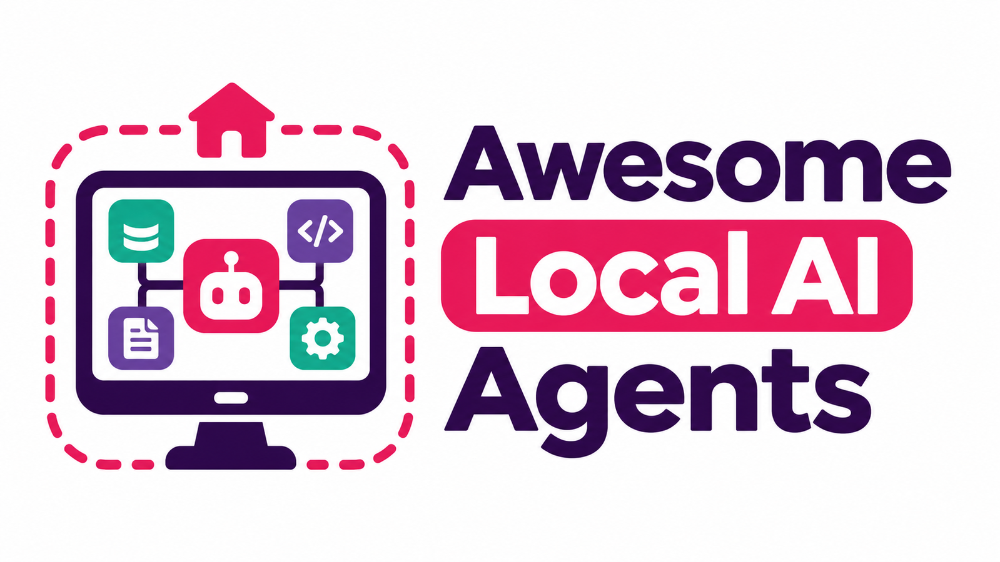

# Awesome Local AI Agents — March 2026 Edition



**🧭 Explore:** [Runners](#local-llm-runners) · [Models](#best-local-models-march-2026) · [Hardware](#hardware-requirements) · [Frameworks](#local-agent-frameworks) · [Quick start](#quick-start-guide)

[](https://awesome.re)
[](https://opensource.org/licenses/MIT)
[](.github/CONTRIBUTING.md)

> Complete guide to local AI agents, models, and tools — self-hosted only, no cloud required.
> Privacy-first. Air-gap compatible. Your data stays yours.
>
> Curated March 2026. Links and repository status re-checked on 31 July 2026;
> the model comparison below still carries its March numbers.

## Table of Contents

- [Local LLM Runners](#local-llm-runners)
- [Best Local Models (March 2026)](#best-local-models-march-2026)
- [Hardware Requirements](#hardware-requirements)
- [Quantization Guide](#quantization-guide)
- [Local Agent Frameworks](#local-agent-frameworks)
- [Local RAG Tools](#local-rag-tools)
- [Privacy and Security](#privacy-and-security)
- [Quick Start Guide](#quick-start-guide)
- [Performance Benchmarks](#performance-benchmarks)
- [Related Lists](#related-lists)

---

## Local LLM Runners

- **[Ollama](https://ollama.com)**<br>
  Stars: 110K+ · Platform: Mac/Linux/Win · Interface: CLI + REST<br>
  Key Feature: Easiest setup, 200+ model library, one-line pulls

- **[LM Studio](https://lmstudio.ai)**<br>
  Stars: — · Platform: Mac/Win/Linux · Interface: GUI<br>
  Key Feature: GGUF model browser, built-in chat, local server

- **[llama.cpp / llama-server](https://github.com/ggml-org/llama.cpp)**<br>
  Stars: 80K+ · Platform: All · Interface: CLI + REST<br>
  Key Feature: Raw performance, Metal/CUDA/CPU backends

- **[vLLM](https://github.com/vllm-project/vllm)**<br>
  Stars: 50K+ · Platform: Linux (GPU) · Interface: REST<br>
  Key Feature: Production serving, PagedAttention, OpenAI-compat

- **[Jan.ai](https://jan.ai)**<br>
  Stars: 28K+ · Platform: Mac/Win/Linux · Interface: GUI<br>
  Key Feature: Privacy-first desktop app, ChatGPT replacement

- **[GPT4All](https://gpt4all.io)**<br>
  Stars: 72K+ · Platform: Mac/Win/Linux · Interface: GUI + CLI<br>
  Key Feature: Runs on CPU only, no GPU required

- **[LocalAI](https://localai.io)**<br>
  Stars: 28K+ · Platform: All (Docker) · Interface: REST<br>
  Key Feature: Drop-in OpenAI API, multimodal, TTS, image gen

- **[koboldcpp](https://github.com/LostRuins/koboldcpp)**<br>
  Stars: 10K+ · Platform: All · Interface: Web UI<br>
  Key Feature: KoboldAI backend, great for creative/roleplay tasks

- **[text-generation-webui](https://github.com/oobabooga/textgen)**<br>
  Stars: 43K+ · Platform: All · Interface: Web UI<br>
  Key Feature: Advanced params, extensions ecosystem, multiple backends


---

## Best Local Models (March 2026)

- ****Llama 4 Scout** (Meta)**<br>
  Parameters: 8B active / MoE · VRAM (Q4): 6 GB · Quant Available: Q4, Q5, Q6, Q8<br>
  Best For: General chat, coding, fast inference

- ****Llama 4 Maverick** (Meta)**<br>
  Parameters: 70B active / MoE · VRAM (Q4): 24 GB · Quant Available: Q2, Q4, Q5<br>
  Best For: Complex reasoning, long context (1M tokens)

- ****Gemma 3 2B** (Google)**<br>
  Parameters: 2B · VRAM (Q4): 2 GB · Quant Available: Q4, Q8<br>
  Best For: Edge devices, embedded, Raspberry Pi

- ****Gemma 3 9B** (Google)**<br>
  Parameters: 9B · VRAM (Q4): 6 GB · Quant Available: Q4, Q6, Q8<br>
  Best For: Best quality-per-VRAM ratio, strong multilingual

- ****Gemma 3 27B** (Google)**<br>
  Parameters: 27B · VRAM (Q4): 16 GB · Quant Available: Q4, Q5, Q6<br>
  Best For: High quality, instruction following, reasoning

- ****Qwen 2.5 7B** (Alibaba)**<br>
  Parameters: 7B · VRAM (Q4): 5 GB · Quant Available: Q4, Q8<br>
  Best For: Code, math, multilingual (Chinese/English)

- ****Qwen 2.5 14B** (Alibaba)**<br>
  Parameters: 14B · VRAM (Q4): 10 GB · Quant Available: Q4, Q6<br>
  Best For: Balanced: coding + reasoning + chat

- ****Qwen 2.5 32B** (Alibaba)**<br>
  Parameters: 32B · VRAM (Q4): 20 GB · Quant Available: Q4, Q5<br>
  Best For: Near-GPT-4 quality, excellent function calling

- ****Qwen 2.5 72B** (Alibaba)**<br>
  Parameters: 72B · VRAM (Q4): 40 GB · Quant Available: Q2, Q4<br>
  Best For: Top-tier open weights, agentic tasks

- ****Qwen3 Coder 480B** (Alibaba)**<br>
  Parameters: 480B MoE · VRAM (Q4): 48 GB+ · Quant Available: Q2<br>
  Best For: State-of-the-art agentic coding

- **DeepSeek V3**<br>
  Parameters: 685B MoE · VRAM (Q4): 32 GB+ · Quant Available: Q2, Q3<br>
  Best For: Top reasoning, cheap to run via MoE sparsity

- **DeepSeek R1**<br>
  Parameters: 671B / distills · VRAM (Q4): 8–40 GB · Quant Available: Q4 (distills)<br>
  Best For: Chain-of-thought reasoning, math, logic

- **Mistral Small 3.1**<br>
  Parameters: 24B · VRAM (Q4): 14 GB · Quant Available: Q4, Q6<br>
  Best For: Fast, function calling, 128K context

- **Mistral Large**<br>
  Parameters: 123B · VRAM (Q4): 64 GB · Quant Available: Q3, Q4<br>
  Best For: Enterprise-grade, multilingual, agentic

- ****Phi-4** (Microsoft)**<br>
  Parameters: 14B · VRAM (Q4): 9 GB · Quant Available: Q4, Q6, Q8<br>
  Best For: Reasoning punch above its weight, STEM tasks

- ****Command R+** (Cohere)**<br>
  Parameters: 104B · VRAM (Q4): 56 GB · Quant Available: Q3, Q4<br>
  Best For: RAG-optimized, 128K context, tool use


> Distilled DeepSeek R1 variants (8B, 14B, 32B, 70B) offer strong reasoning at consumer VRAM levels.

---

## Hardware Requirements

- **4–6 GB GPU**<br>
  Best Models: Gemma 3 2B Q8, Llama 4 Scout Q4, Phi-4 Q2<br>
  Use Case: Light chat, fast responses, edge deployment

- **8 GB GPU**<br>
  Best Models: Gemma 3 9B Q4, Llama 4 Scout Q5, Qwen 2.5 7B Q8, Mistral 7B Q8<br>
  Use Case: Daily driver for coding and chat

- **16 GB GPU**<br>
  Best Models: Qwen 2.5 14B Q6, Gemma 3 27B Q4, Mistral Small Q4, Phi-4 Q8<br>
  Use Case: Strong coding, reasoning, agentic tasks

- **24 GB GPU**<br>
  Best Models: Qwen 2.5 32B Q4, Llama 4 Maverick Q4, DeepSeek R1 32B distill<br>
  Use Case: Near-frontier quality for most tasks

- **40–48 GB GPU**<br>
  Best Models: Qwen 2.5 72B Q4, DeepSeek V3 Q2, Command R+ Q3<br>
  Use Case: Production-grade, multi-user serving

- **64 GB+ GPU**<br>
  Best Models: Full precision mid-size models, vLLM serving<br>
  Use Case: High-throughput API servers

- **CPU only**<br>
  Best Models: Gemma 3 2B, Phi-4 Q2, GPT4All models<br>
  Use Case: Air-gapped, no GPU, privacy boxes


### Apple Silicon (M-Series) Recommendations

- **M3 / M4 (base)**<br>
  Unified Memory: 16 GB<br>
  Recommended Models: Gemma 3 9B Q6, Llama 4 Scout Q5, Qwen 2.5 7B Q8

- **M3 / M4 Pro**<br>
  Unified Memory: 24–36 GB<br>
  Recommended Models: Qwen 2.5 14B Q8, Mistral Small Q4, Gemma 3 27B Q4

- **M3 / M4 Max**<br>
  Unified Memory: 48–128 GB<br>
  Recommended Models: Qwen 2.5 32B Q8, DeepSeek R1 32B distill Q8, Llama 4 Maverick Q4

- **M3 / M4 Ultra**<br>
  Unified Memory: 192 GB<br>
  Recommended Models: DeepSeek V3 Q3, Qwen 2.5 72B Q6, Command R+ Q6


> Ollama + llama.cpp both have excellent Metal acceleration — Apple Silicon is first-class for local AI.

---

## Quantization Guide

### Formats

- **GGUF**<br>
  Engine: llama.cpp, Ollama, LM Studio, koboldcpp · Strengths: Universal, CPU+GPU, actively maintained<br>
  Weaknesses: Slightly slower than native GPU formats

- **AWQ**<br>
  Engine: vLLM, HF Transformers · Strengths: Activation-aware, minimal quality loss<br>
  Weaknesses: GPU-only, requires calibration data

- **GPTQ**<br>
  Engine: vLLM, AutoGPTQ, text-gen-webui · Strengths: Mature, broad support<br>
  Weaknesses: Slightly more quality loss than AWQ

- **EXL2**<br>
  Engine: ExLlamaV2 · Strengths: Highest GPU throughput, flexible bits<br>
  Weaknesses: Complex setup, GPU-only

- **BitsAndBytes**<br>
  Engine: HF Transformers · Strengths: Easy integration, 4/8-bit<br>
  Weaknesses: Slower inference, research-grade


### Quality vs Size Tradeoffs

- **Q2_K**<br>
  Size vs FP16: ~25% · Quality Loss: High<br>
  Recommendation: Last resort for extreme VRAM limits

- **Q3_K_M**<br>
  Size vs FP16: ~35% · Quality Loss: Moderate<br>
  Recommendation: Acceptable for very large models (70B+)

- **Q4_K_M**<br>
  Size vs FP16: ~45% · Quality Loss: Low<br>
  Recommendation: **Sweet spot** — default recommendation

- **Q5_K_M**<br>
  Size vs FP16: ~55% · Quality Loss: Very Low<br>
  Recommendation: When VRAM allows, clear quality gain

- **Q6_K**<br>
  Size vs FP16: ~65% · Quality Loss: Minimal<br>
  Recommendation: Near-lossless for most tasks

- **Q8_0**<br>
  Size vs FP16: ~80% · Quality Loss: Negligible<br>
  Recommendation: Effectively full quality, if VRAM fits


> Rule of thumb: prefer Q4_K_M as default, step up to Q5/Q6 if you have headroom.

---

## Local Agent Frameworks

- **[CrewAI](https://github.com/crewAIInc/crewAI)**<br>
  Stars: 38K+ · Language: Python · Ollama Support: Native<br>
  Best For: Role-based multi-agent teams, easy API

- **[LangChain](https://github.com/langchain-ai/langchain)**<br>
  Stars: 116K+ · Language: Python/JS · Ollama Support: Native<br>
  Best For: Complex pipelines, massive integration library

- **[LangGraph](https://github.com/langchain-ai/langgraph)**<br>
  Stars: 19K+ · Language: Python · Ollama Support: Via LangChain<br>
  Best For: Stateful workflows, cyclical graphs, human-in-the-loop

- **[AutoGen](https://github.com/microsoft/autogen)**<br>
  Stars: 50K+ · Language: Python · Ollama Support: Via OpenAI-compat<br>
  Best For: Conversational multi-agent, Microsoft research

- **[AnythingLLM](https://github.com/Mintplex-Labs/anything-llm)**<br>
  Stars: 35K+ · Language: TypeScript · Ollama Support: Native<br>
  Best For: All-in-one: RAG + agents + chat UI, zero-config

- **[Open Interpreter](https://github.com/openinterpreter/openinterpreter)**<br>
  Stars: 56K+ · Language: Python · Ollama Support: Native<br>
  Best For: Natural language computer control, code execution

- **[Aider](https://github.com/Aider-AI/aider)**<br>
  Stars: 26K+ · Language: Python · Ollama Support: Via Ollama<br>
  Best For: AI pair programmer, git-aware, multi-file edits

- **[Continue.dev](https://github.com/continuedev/continue)**<br>
  Stars: 22K+ · Language: TypeScript · Ollama Support: Native<br>
  Best For: VS Code/JetBrains AI IDE extension, local first

- **[SmolAgents](https://github.com/huggingface/smolagents)**<br>
  Stars: 15K+ · Language: Python · Ollama Support: Via HF<br>
  Best For: Minimal code agents (~1K LOC), HuggingFace ecosystem

- **[OpenHands](https://github.com/OpenHands/OpenHands)**<br>
  Stars: 45K+ · Language: Python · Ollama Support: Via Ollama<br>
  Best For: Full software dev agent, Docker isolation

- **[Dify](https://github.com/langgenius/dify)**<br>
  Stars: 55K+ · Language: Python/TS · Ollama Support: Native<br>
  Best For: Visual workflow builder, RAG, multi-agent UI

- **[Flowise](https://github.com/FlowiseAI/Flowise)**<br>
  Stars: 32K+ · Language: TypeScript · Ollama Support: Native<br>
  Best For: Drag-and-drop agent builder, no-code

- **[Agno](https://github.com/agno-agi/agno)**<br>
  Stars: 35K+ · Language: Python · Ollama Support: Via Ollama<br>
  Best For: Multimodal agents, agent runtime + control plane


### Quickstart: CrewAI + Ollama

```bash
pip install crewai crewai-tools langchain-ollama
ollama pull gemma3:9b
```

```python
from crewai import Agent, Task, Crew
from langchain_ollama import OllamaLLM

llm = OllamaLLM(model="gemma3:9b")

researcher = Agent(
    role="Research Analyst",
    goal="Find and summarize information on given topics",
    backstory="Expert researcher with attention to detail",
    llm=llm
)

task = Task(
    description="Research the latest advances in local AI models",
    expected_output="A concise summary with key findings",
    agent=researcher
)

result = Crew(agents=[researcher], tasks=[task]).kickoff()
print(result)
```

---

## Local RAG Tools

- **[AnythingLLM](https://github.com/Mintplex-Labs/anything-llm)**<br>
  Stars: 35K+ · Interface: GUI + API · Vector DB: LanceDB, Chroma, Pinecone<br>
  Best For: Zero-config all-in-one, multi-user workspaces

- **[PrivateGPT](https://github.com/zylon-ai/private-gpt)**<br>
  Stars: 54K+ · Interface: API + UI · Vector DB: Qdrant<br>
  Best For: Fully local document Q&A, no leakage guarantee

- **[LocalGPT](https://github.com/PromtEngineer/localGPT)**<br>
  Stars: 21K+ · Interface: CLI + Web · Vector DB: Chroma<br>
  Best For: GPU-accelerated, simple setup, document ingestion

- **[Khoj](https://github.com/khoj-ai/khoj)**<br>
  Stars: 24K+ · Interface: Web + App · Vector DB: SQLite + pgvector<br>
  Best For: Personal AI assistant, notes, calendar, web search

- **[Chroma](https://github.com/chroma-core/chroma)**<br>
  Stars: 18K+ · Interface: Embedded + Server · Vector DB: Native<br>
  Best For: Embedded vector DB, Python-native, zero infra

- **[Qdrant](https://github.com/qdrant/qdrant)**<br>
  Stars: 22K+ · Interface: REST + gRPC · Vector DB: Native<br>
  Best For: High-performance, Rust-based, production-ready

- **[Weaviate](https://github.com/weaviate/weaviate)**<br>
  Stars: 12K+ · Interface: REST + GraphQL · Vector DB: Native<br>
  Best For: Multi-modal, built-in vectorization, self-hosted

- **[Milvus](https://github.com/milvus-io/milvus)**<br>
  Stars: 32K+ · Interface: REST · Vector DB: Native<br>
  Best For: Enterprise-scale vector search, GPU acceleration


### Quickstart: AnythingLLM (Easiest Path)

```bash
# Docker one-liner — full RAG stack in 60 seconds
docker run -d -p 3001:3001 \
  -v ~/.anythingllm:/app/server/storage \
  mintplexlabs/anythinglm

# Open http://localhost:3001 → connect Ollama → upload docs → chat
```

---

## Privacy and Security

### Why Local AI Matters

- **Data leaves device**<br>
  Cloud AI: Always<br>
  Local AI: Never

- **GDPR / DSGVO compliance**<br>
  Cloud AI: Complex, consent required<br>
  Local AI: Inherent — no data transfer

- **HIPAA compliance**<br>
  Cloud AI: BAA required, complex<br>
  Local AI: Achievable with proper infra

- **Air-gapped operation**<br>
  Cloud AI: Impossible<br>
  Local AI: Native

- **Audit trail**<br>
  Cloud AI: Provider-dependent<br>
  Local AI: Full control

- **Prompt injection via API**<br>
  Cloud AI: Risk of data exfil<br>
  Local AI: Contained to local machine

- **Model updates you didn't ask for**<br>
  Cloud AI: Automatic<br>
  Local AI: You decide


### Air-Gapped Deployment Pattern

```bash
# 1. Pre-download models on a connected machine
ollama pull gemma3:9b
# Models stored at ~/.ollama/models/

# 2. Copy model files to air-gapped machine via USB/internal network
rsync -av ~/.ollama/models/ airgapped-host:~/.ollama/models/

# 3. Run Ollama on air-gapped host — fully offline
OLLAMA_HOST=0.0.0.0 ollama serve
```

### GDPR / DSGVO Checklist

- Data processing stays within your infrastructure (Art. 5 GDPR)
- No third-party sub-processors for AI inference
- No model training on your prompts/data
- Encryption at rest: encrypt the disk hosting model weights and vector DBs
- Logging: control what gets persisted, easy to implement right-to-erasure

---

## Quick Start Guide

### 30-Second Setup (Ollama)

```bash
# 1. Install Ollama (macOS/Linux)
curl -fsSL https://ollama.com/install.sh | sh

# Windows: download from https://ollama.com/download

# 2. Pull a model
ollama pull gemma3:9b        # 6 GB — best default choice
# ollama pull phi4           # 9 GB — strong reasoning
# ollama pull qwen2.5:14b    # 10 GB — best for coding

# 3. Start chatting
ollama run gemma3:9b

# 4. Use the OpenAI-compatible API
curl http://localhost:11434/v1/chat/completions \
  -H "Content-Type: application/json" \
  -d '{"model":"gemma3:9b","messages":[{"role":"user","content":"Hello!"}]}'
```

### Agent Setup: Aider + Local Model

```bash
pip install aider-chat
aider --model ollama/gemma3:9b --no-auto-commits
```

### Agent Setup: Open Interpreter + Ollama

```bash
pip install open-interpreter
interpreter --model ollama/gemma3:9b
```

### Agent Setup: Continue.dev (VS Code)

1. Install the [Continue extension](https://marketplace.visualstudio.com/items?itemName=Continue.continue)
2. Open `~/.continue/config.json`
3. Add an Ollama provider — autocomplete, chat, and inline edits run fully local

---

## Performance Benchmarks

Approximate relative scores on common agent tasks (higher = better, community benchmarks, March 2026):

- **Gemma 3 9B Q4**<br>
  Coding: 7/10 · Reasoning: 7/10 · Chat Quality: 8/10 · Multilingual: 8/10<br>
  Speed (tok/s, 8GB GPU): ~60

- **Qwen 2.5 14B Q4**<br>
  Coding: 9/10 · Reasoning: 8/10 · Chat Quality: 8/10 · Multilingual: 9/10<br>
  Speed (tok/s, 8GB GPU): ~35

- **Phi-4 14B Q4**<br>
  Coding: 8/10 · Reasoning: 9/10 · Chat Quality: 7/10 · Multilingual: 6/10<br>
  Speed (tok/s, 8GB GPU): ~30

- **Llama 4 Scout Q4**<br>
  Coding: 8/10 · Reasoning: 8/10 · Chat Quality: 8/10 · Multilingual: 7/10<br>
  Speed (tok/s, 8GB GPU): ~65

- **Mistral Small 24B Q4**<br>
  Coding: 8/10 · Reasoning: 8/10 · Chat Quality: 9/10 · Multilingual: 8/10<br>
  Speed (tok/s, 8GB GPU): ~20

- **Qwen 2.5 32B Q4**<br>
  Coding: 9/10 · Reasoning: 9/10 · Chat Quality: 9/10 · Multilingual: 9/10<br>
  Speed (tok/s, 8GB GPU): ~14

- **DeepSeek R1 14B distill Q4**<br>
  Coding: 8/10 · Reasoning: 10/10 · Chat Quality: 7/10 · Multilingual: 6/10<br>
  Speed (tok/s, 8GB GPU): ~28

- **Gemma 3 27B Q4**<br>
  Coding: 8/10 · Reasoning: 9/10 · Chat Quality: 9/10 · Multilingual: 9/10<br>
  Speed (tok/s, 8GB GPU): ~18


> Benchmarks vary heavily by task and hardware. Always test on your own use case.
> Speed measured on a single RTX 4090 (24 GB). Apple M4 Max is within 20% for most models.

---

## Related Lists

| Resource | Description |
|----------|-------------|
| [awesome-ai-agents-2025](https://github.com/e2b-dev/awesome-ai-agents) | Broad AI agents list, cloud + local, 24K+ stars |
| [awesome-llm](https://github.com/Hannibal046/Awesome-LLM) | LLM papers, tools, and resources |
| [awesome-local-llm](https://github.com/vince-lam/awesome-local-llms) | Focused local LLM tools comparison |
| [500-AI-Agents-Projects](https://github.com/ashishpatel26/500-AI-Agents-Projects) | Real-world agent implementations, 16K+ stars |
| [r/LocalLLaMA](https://reddit.com/r/LocalLLaMA) | 600K+ member community, hardware tips, model releases |

---

## Contributing

PRs welcome. Focus on self-hosted / local-only tools — no cloud services.
Please include: GitHub link, star count, brief description of what makes it worth adding.

See [CONTRIBUTING.md](.github/CONTRIBUTING.md) for full guidelines.

## License

MIT — see [LICENSE](LICENSE).

---

**Star this repo** if it saved you time. [Report an Issue](https://github.com/Supersynergy/awesome-local-ai-agents/issues) | [Request a Feature](https://github.com/Supersynergy/awesome-local-ai-agents/issues/new)
